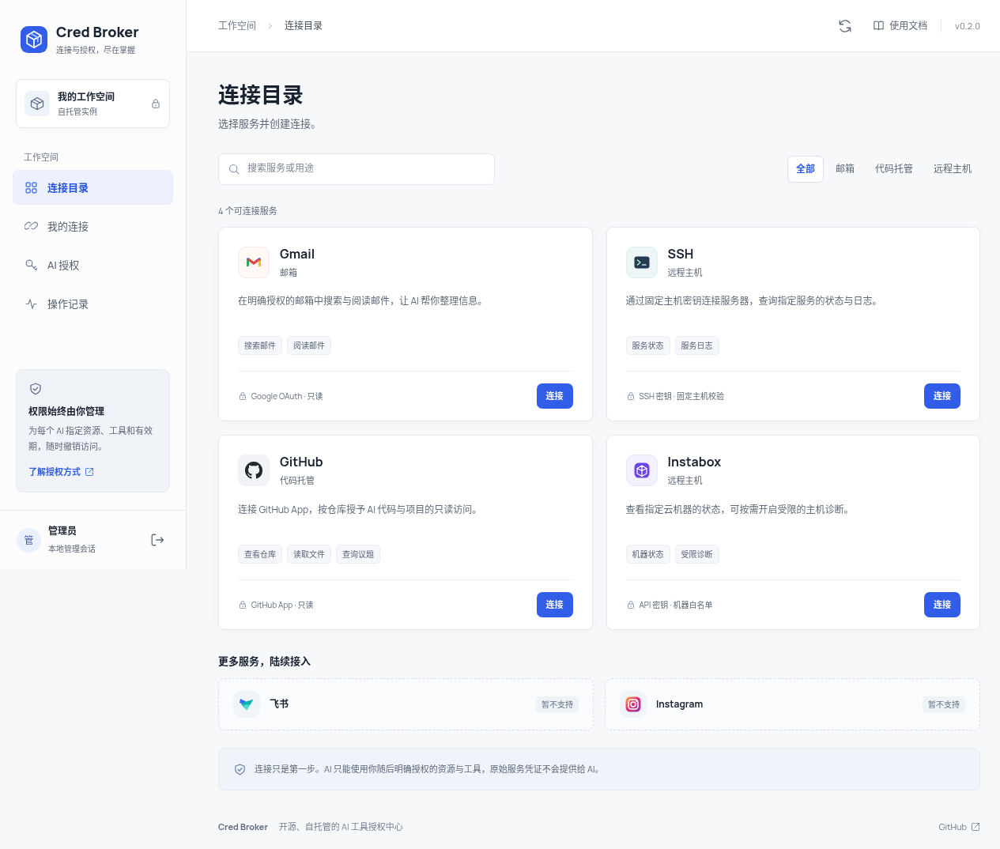

# Cred Broker · 授权中心

[English overview](README.en.md) · [贡献指南](CONTRIBUTING.md) · [集成指南](docs/integration.md)

一个可自部署的开源授权网关：连接 Gmail、SSH、GitHub 和 Instabox，按资源、工具和有效期把权限交给 AI。服务负责使用真实凭证，AI 获得的是可撤销的短期网关令牌。

首版面向个人和小团队的单实例部署。管理台为简体中文，前端无需构建、无需 CDN；提供标准 MCP Streamable HTTP，使用 MIT 许可证。不包含模型账号或模型 API 授权。



**v0.3.1 已发布并部署，是安全与正确性改造的第一批，范围为 T00–T03。** 本批加入已有库启动失败关闭、空库密钥配对 unproven、精确 Host/Origin 与实际请求体预算、本地业务和审计同事务，以及结果未知时不自动重试的流程。它没有完成整份 17 张任务卡，也没有把本机 LAN 切换为 HTTPS。公开制品与本机部署结果见[版本说明](docs/releases/v0.3.1.md)和[验收记录](docs/validation.md)，后续范围见[改造计划](docs/ai-refactor-plan-2026-11-25.md)。v0.3.0 的历史公开镜像与运维能力见[历史版本说明](docs/releases/v0.3.0.md)。

## 已实现

| 连接 | 身份方式 | 可授权工具 |
|---|---|---|
| Gmail | 自己的 Google OAuth 客户端、浏览器同意 | 搜索邮件、读取正文；仅 `gmail.readonly` |
| SSH | 专用私钥、固定主机公钥、非 root 账号 | 指定 systemd 服务的状态与最近日志 |
| GitHub | GitHub App 安装与 RSA 私钥 | 选定仓库的文件、Issue、PR，只读 |
| Instabox | 官方 API Key | 指定机器的状态；可选独立密钥开放运行时长、磁盘和内存诊断 |
| 飞书、Instagram | 尚未接入 | 目录中显示图标和「暂不支持」，无法建立连接 |

四个页面覆盖连接目录、我的连接、AI 授权和操作记录。v0.2.0 使用明亮的权限工作台，突出服务身份、具体资源与工具，以及可撤销状态；不展示虚构健康评分、调用量或活动。一个授权绑定一个连接、具体资源、具体工具和有效期。令牌仅在签发时显示一次；撤销后拒绝新请求，断开连接会同时撤销关联授权。

## 用 Docker Compose 部署

需要 Docker Engine 和 Compose v2。Compose 固定目标镜像版本，发布流水线提供 Linux amd64；部署前先确认目标版本已在 [验收记录](docs/validation.md) 完成发布验收。未发布的候选版本只能先在隔离环境源码构建，不能把镜像名写入 Compose 当作已经发布。

```bash
git clone https://github.com/gnod-x/cred-broker.git
cd cred-broker
cp .env.example .env
chmod 600 .env
python3 -c 'import secrets; print(secrets.token_urlsafe(32))'
# 把生成的随机值填入 .env 的 CB_ADMIN_TOKEN。
docker compose up -d --pull always --no-build
docker compose ps
```

浏览器打开 **http://localhost:8765**，用刚设置的管理令牌登录。Compose 默认只把端口映射到宿主机回环地址。远程访问可使用 SSH 转发：

```bash
ssh -N -L 8765:127.0.0.1:8765 your-user@your-server
```

端口冲突时可在 `.env` 设置 `CB_HOST_PORT=18765`；容器内部仍使用 8765，同时必须在 `CB_ALLOWED_ORIGINS` 登记实际入口，例如 `["http://localhost:18765","http://127.0.0.1:18765"]`。修改环境后用 `docker compose up -d --force-recreate`，仅 restart 不会加载新的 Compose 环境。浏览器管理会话使用独立随机值，有效期 8 小时，退出或重启服务后失效；升级到本版本需重新登录。登录尝试按来源最多每分钟 8 次、实例合计每分钟 64 次，超限返回 `429` 与 `Retry-After`。反向代理后的用户可能共享来源额度；管理 API 仍可使用 `X-Admin-Token`。

LAN 或域名入口必须在 `CB_ALLOWED_ORIGINS` 精确登记。Host 与可选 Origin 均按白名单校验；原生 MCP/API 可不带 Origin，但不能绕过 Host 或认证。默认上限为实际接收 65536 字节、整个请求体读取 10 秒；超限 413，到期 408，不等于 provider 动作的总期限。正式入口关闭 proxy_headers，不信任客户端伪造的 `X-Forwarded-*`。

本机现有 LAN 管理地址为 `http://192.168.101.240:8765/admin`，MCP 和健康地址为同源 `/mcp`、`/healthz`；旧 Tailscale 入口保留，LAN 不以 Tailscale 为前提。本批未部署生产 TLS，HTTP 链路中的登录秘密、Cookie、Bearer 与结果仍有被同网段观察或篡改的风险。HTTPS 的名称、CA 信任与代理模板见 [LAN HTTPS ADR](docs/adr/0001-lan-https.md)。TLS 代理部署时把 `CB_PUBLIC_ORIGIN` 设为精确 HTTPS origin，Cookie 会强制 Secure；这会影响旧 HTTP 浏览器登录，须先安排切换，不可直接套用模板。

镜像以 UID/GID 10001 运行，根文件系统只读、不挂载宿主机 home、Docker socket 或 SSH agent，数据存在命名 volume `broker-data`。镜像附带校验 SHA-512 后安装的官方 Instabox CLI；不会导入宿主机现有 Instabox 登录。

源码构建可使用 `docker compose up -d --build`，构建时需要访问 Docker Hub、PyPI 和 npm registry。ARM64 主机目前需要自行构建与验收，发布流水线暂只提供 amd64 镜像。

Linux/systemd 部署可用 `sudo bash deploy.sh`，默认安装到 `/opt/cred-broker`。需要 Python 3.11+、venv、OpenSSH client 和 curl；脚本生成独立服务用户、首次管理令牌及服务单元。该脚本尚不替你配置域名或 HTTPS。

## 连接服务

### Gmail

1. 在自己的 Google Cloud 项目中启用 Gmail API，配置 OAuth consent screen，创建 Web application 类型的 OAuth client。
2. 测试状态下，把需要连接的邮箱加入测试用户。在客户端中登记精确回调地址，例如 `http://localhost:8765/admin/oauth/google/callback`。
3. 在 `.env` 中同时设置 `CB_GOOGLE_CLIENT_ID`、`CB_GOOGLE_CLIENT_SECRET`、`CB_GOOGLE_REDIRECT_URI`，然后运行 `docker compose up -d`。
4. 在连接目录选择 Gmail，通过 Google 页面同意只读权限。

采用随机 state、浏览器绑定 cookie、PKCE S256 和十分钟时限；回调只能使用一次。客户端 secret、refresh token 和连接配置在数据库中加密，access token 只用于当前调用。发信、删除邮件和附件下载未开放。

Gmail 正文只读权限属于 Google 的 restricted scopes。供自己部署与使用的测试应用仍受 Google 测试用户、令牌期限等规则约束；共用的公开 OAuth 应用需要按 Google 要求完成验证，可能涉及额外评估。请参考 [Gmail scopes](https://developers.google.com/workspace/gmail/api/auth/scopes) 和 [OAuth verification](https://developers.google.com/identity/protocols/oauth2/production-readiness/restricted-scope-verification)。测试状态通常会影响 refresh token 寿命，失效后重新连接。

### SSH 与普通云主机

先创建只能读取目标服务状态和必要日志的专用非 root 账号，安装它的公钥。管理台填写主机、端口、账号、私钥、目标主机公钥及允许查询的 `*.service` 名称。

主机公钥格式为 `ssh-ed25519 AAAA...` 等公钥本体；通过可信控制台或已有可信连接核对指纹，不能只因 `ssh-keyscan` 输出了一个 key 就信任它。运行中始终严格验证固定主机公钥，并禁用 SSH agent、交互认证及转发。

只执行固定的 `systemctl show` 和 `journalctl` 查询，不接收 shell 字符串。日志仍可能包含业务数据，应在目标机限制账号的读取权限。

### GitHub

创建自己的 GitHub App，设置需要的只读 repository permissions：Contents、Issues、Pull requests，以及必要的 Metadata。安装时只选择允许访问的仓库，再生成 App RSA 私钥。

在管理台填写 App ID、Installation ID、`owner/repository` 清单和 PEM 私钥。每次动作申请只限当前仓库和权限的短期 installation token，并核对仓库属于登记的 installation。无需配置 GitHub OAuth 回调或接收 webhook。

首版不提供 push、建仓库、提交 Issue/PR 或合并权限。你的 GitHub SSH 登录也不自动成为网关的 GitHub App 连接。

### Instabox

使用官方 CLI 在自己的登录环境中创建查询专用 key，避免使用 CLI 默认的宽权限：

```bash
instabox keys create --name cred-broker-read --scope machines:read --expires-in-days 30
```

把 key 和允许的机器 ID 填入管理台。若需要固定诊断，再单独创建 `machines:write` key，填入可选的诊断密钥：

```bash
instabox keys create --name cred-broker-diagnostics --scope machines:write --expires-in-days 30
```

Instabox 把远程执行包含在 `machines:write` 中；网关进一步限制到已登记的机器和 `uptime/disk/memory` 三种预设操作。查询始终用 read key，诊断只用 diagnostic key。首版不开放启停、删除、创建机器、文件传输或发布公网端口。

## 让 AI 调用

在「AI 授权」选择连接、资源和工具，设置有效期后签发。默认界面提供 15 分钟到一天，服务端最长一天。不支持通配资源，也不把管理员令牌发给 AI。

MCP 地址为 `http://localhost:8765/mcp`，认证头为 `Authorization: Bearer <本次签发的网关令牌>`。MCP 客户端的配置方式因产品而异，可在支持 HTTP MCP 和自定义 Bearer 的客户端中填入这两项。客户端若仅支持 stdio，需要另配可信的 HTTP bridge；内置的是标准 HTTP 入口。

管理台签发窗口会给出通用配置片段。片段只包含 MCP URL 和 `Bearer ${CRED_BROKER_TOKEN}` 占位符；不要把管理员令牌或实际网关令牌提交到仓库。当前仓库只验证标准 HTTP 请求和官方 MCP SDK 回环流程，不宣称已经兼容某个具体第三方客户端。

管理员可在 `GET /admin/api/v1/ready` 查看版本、存储、已加载主密钥、`key_pairing` 和必需表/列状态。启动时扫描所有已有密文，配对为 verified 或 unproven；空库没有可供证明的密文，必须为 unproven。readiness 不在每次请求重新全库解密，也不检查外部 provider，不代表连接可用。连接目录中的“测试连接”是管理员显式触发的 provider 检查；结果只保存最近一次成功/失败时间和状态。

集成方可用管理员认证的 `GET /admin/api/v1/providers/{provider}/schema` 获取连接表单和能力描述。返回值只包含非秘密 JSON Schema、OAuth/API key 认证模式、工具参数和资源约束；secret 字段仅描述字段名并标记 `writeOnly`，不会返回客户端 secret、私钥或 token。SSH 的资源以已创建连接的 `connection.resources` 为准，不能由通用正则推断主机范围。

维护者可在运行服务的同一环境执行只读部署检查：

```bash
docker compose exec cred-broker python -m cred_broker doctor
# 源码运行：在已配置 CB_* 的同一环境执行 python -m cred_broker doctor
```

doctor 检查本地配置、文件属主和 0400/0600 权限；不创建密钥、不外联、不打印秘密。无辅助文件的独立数据库执行 quick_check 和共享密文/JSON 配对检查；live WAL/SHM/journal 明确跳过完整性及配对检查，提示使用独立备份。key-only/db-only 部分安装均报错。正式启动还会进行 WAL 感知的只读预检，不依赖操作者先运行 doctor。

「操作记录」页面支持按日期下载脱敏 CSV；接口为 `GET /admin/api/v1/audit/export.csv`，管理员认证后可用 `after`/`before` Unix 秒过滤，单次最多查询 31 天。导出仅含时间、客户端、动作、连接、资源和结果，不含工具参数、正文、secret 或 token。

授权重签发使用 `POST /admin/api/v1/grants/{grant_id}/reissue`，可传 `{"ttl_seconds": 900}`。服务在一个事务中创建同范围的新 grant 并撤销旧 grant；新 token 只在该响应中出现一次，旧 token 立即不能用于新请求。

创建连接、创建授权、撤销、断开和重签发的本地状态与审计同事务；审计写失败会回滚本地修改。远端操作无法与 SQLite 原子提交：若操作已接纳但结果或审计无法确认，返回 `outcome_unknown`、`retryable=false`；MCP 以 isError 工具结果表达。客户端不能自动重试。签发窗口在 pending 或令牌待保存时保护关闭；网络中断后先刷新清单，按客户端、连接、时间核对，再撤销或重签发，不能直接再签一次。

下面是协议层示例，网关令牌由环境变量提供：

```bash
curl -sS http://localhost:8765/mcp \
  -H "Authorization: Bearer $CRED_BROKER_TOKEN" \
  -H 'Content-Type: application/json' \
  -H 'Accept: application/json, text/event-stream' \
  -d '{"jsonrpc":"2.0","id":1,"method":"tools/list"}'
```

工具的 `resource` 参数枚举只包含该授权的资源。例如已授权 Instabox 状态查询时：

```json
{
  "jsonrpc": "2.0",
  "id": 2,
  "method": "tools/call",
  "params": {
    "name": "instabox_describe",
    "arguments": {"resource": "your-authorized-machine-id"}
  }
}
```

撤销不能撤回已经发到远端的动作；已接纳的在途请求可能完成。后续请求会立即拒绝。首版单实例、单 worker，不声称提供跨进程或分布式撤销。

## 配置、备份与升级

| 配置 | 默认值 / 用途 |
|---|---|
| `CB_ADMIN_TOKEN` | 必填，独立随机管理令牌 |
| `CB_DATA_DIR` | `/var/lib/cred-broker`，数据库和主密钥 |
| `CB_BIND` | 源码运行 `127.0.0.1:8765`；容器内部 `0.0.0.0:8765` |
| `CB_PUBLIC_ORIGIN` | 默认空；TLS 反向代理时设为精确的外部 origin，如 `https://broker.example.com` |
| `CB_HOST_PORT` | Compose 宿主机回环端口，默认 8765；非默认端口需登记外部 origin |
| `CB_ALLOWED_ORIGINS` | 默认 `[]`，JSON 数组中的精确 LAN/代理 HTTP(S) origin，无通配 |
| `CB_MAX_REQUEST_BODY` | 默认 65536，允许 1024–65536，累计实际接收字节 |
| `CB_BODY_READ_TIMEOUT` | 默认 10 秒，须大于 0 且不超过 60，整个请求体读取期限 |
| `CB_GOOGLE_CLIENT_ID/SECRET/REDIRECT_URI` | 三项同时配置才开启 Gmail OAuth |
| `CB_INSTABOX_CLI` | `/usr/local/bin/instabox`，由管理员指定的可执行文件 |
| `CB_ENABLE_LEGACY` | 默认 false，仅迁移时按需启用旧管理和旧 HTTP 调用 |

启动只会在 key/db 均不存在时创建全新配对。已有数据库缺 key、短/错 key、坏密文、无效 JSON、缺表或坏权限会在监听前失败，不生成替代密钥，不修改 schema“修复”旧库。新安装私有暂存后无覆盖发布；中断残留 key-only/db-only 时保留文件并拒绝启动，需恢复原配对。正常只读 WAL 预检允许 SQLite 创建空辅助文件或更新 SHM 读者元数据，不执行业务写或 checkpoint。

备份必须同时包含数据卷里的 `broker.db`、相关 WAL 状态和 `master.key`。最简单的方式是先 `docker compose stop`，再完整备份数据卷到加密存储，完成后 `docker compose start`。主密钥丢失后不能恢复凭证；数据库与主密钥一起泄露则可以解密，文件权限与主机隔离仍然必要。另行妥善保存 `.env`，不要提交到 Git。

恢复前，可在安装了项目依赖的可信环境检查独立备份：

```bash
python -m cred_broker backup-check --db /secure/backup/broker.db --key /secure/backup/master.key
```

该命令核验 SQLite 完整性、必需表结构与全部已有加密记录，不写入原文件，不恢复数据，也不输出凭证。使用已停止写入的数据库副本或 SQLite backup API 导出的独立数据库；有 `-wal/-shm/-journal` 时会拒绝，应先在副本上合并状态或重新制作快照，不能直接删除有未合并数据的 WAL。空库无法确认密钥配对，输出会明确说明。通过预检后，仍须在独立环境恢复、解密连接并验证授权行为，完整恢复步骤见 [集成与运维说明](docs/integration.md)。

升级前备份，记录现用 Git tag 或镜像版本，更新 Compose 中的目标镜像版本后拉取并启动；源码部署则重新构建。回滚同时考虑代码与数据格式，不能假定降级总兼容。新表与原有 cred-broker 的凭证、授权和 token 表隔离，不自动迁移旧授权；开启兼容模式的范围与边界见 [架构说明](docs/architecture.md)。

## 开发与测试

```bash
python3 -m venv .venv
.venv/bin/pip install --no-cache-dir -r requirements-dev.txt
.venv/bin/python -IB tests/test_core.py
.venv/bin/python -IB tests/test_control.py
.venv/bin/python -IB tests/test_providers.py
.venv/bin/python -IB tests/test_google.py
.venv/bin/python -IB tests/test_app.py
.venv/bin/python -IB tests/test_ssh_transport.py
.venv/bin/python -IB tests/test_mcp_sdk.py
.venv/bin/python -IB tests/test_admin_auth.py
.venv/bin/python -IB tests/test_doctor.py
.venv/bin/python -IB tests/test_backup_check.py
.venv/bin/python -IB tests/test_release_notes.py
.venv/bin/python -IB tests/test_startup.py
.venv/bin/python -IB tests/test_http_security.py
.venv/bin/python -IB tests/test_release_regressions.py
```

测试使用隔离数据库、假凭证与 mock upstream。SDK 测试启动临时回环 HTTP 服务器，通过官方 MCP Python 客户端完成握手、发现、调用和撤销验证。真实 Gmail、GitHub App 与 Instabox 账号授权需要部署者提供；mock 通过不代表那些账号已经连接。

浏览器测试需要 `.venv/bin/python -m playwright install --with-deps chromium`，并启动专用 fixture：

```bash
export CB_TEST_FIXTURE=1 CB_TEST_ADMIN_TOKEN=browser-fixture-only CB_ADMIN_TOKEN=browser-fixture-only
export CB_DATA_DIR=/tmp/cred-broker-browser-fixture
.venv/bin/python -m uvicorn tests.browser_fixture:app --host 127.0.0.1 --port 18765
# 在另一终端保留同样的 CB_TEST_FIXTURE / CB_TEST_ADMIN_TOKEN 设置：
.venv/bin/python -B tests/test_browser.py
```

浏览器 fixture 只能用作测试。CI 会执行功能、官方 SDK、浏览器与容器测试；发布时先构建一个候选镜像，以独立随机 Compose project 验收完全相同的 image ID，再发布并拉回 digest 重验。镜像内不写入自身最终 OCI digest；发布摘要保存在独立 artifact。也可在 GitHub Actions 的 Container release 页面手动选择已有的 `vMAJOR.MINOR.PATCH` 标签补发；任务会核验实际检出的代码与该标签一致。

公开镜像验收后，把 `docs/releases/vMAJOR.MINOR.PATCH.md` 说明提交到 `main`。Release notes 流程核对版本标签和该标签触发的镜像流水线，确认成功后创建对应的 GitHub Release。正文相同的已有发布页会被直接复用。

凭证加密不能替代主机隔离，授权也不能自动消除 prompt injection。完整边界与限制见 [安全说明](docs/security.md)。

首版的测试范围和限制见 [验收记录](docs/validation.md)。
